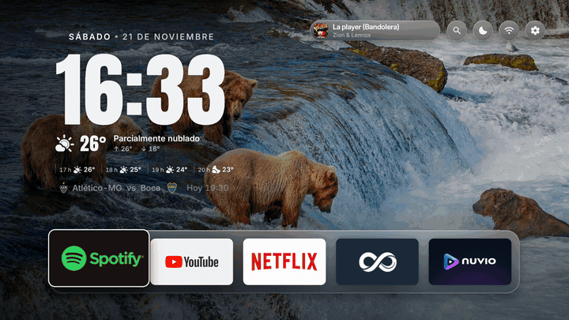
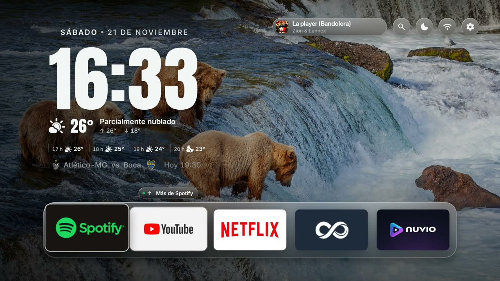
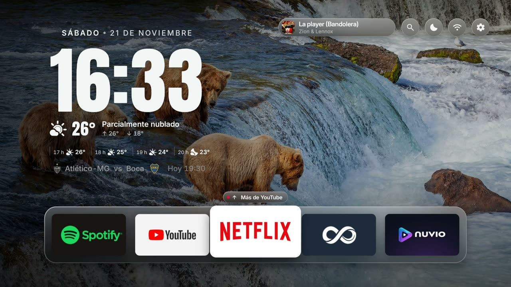
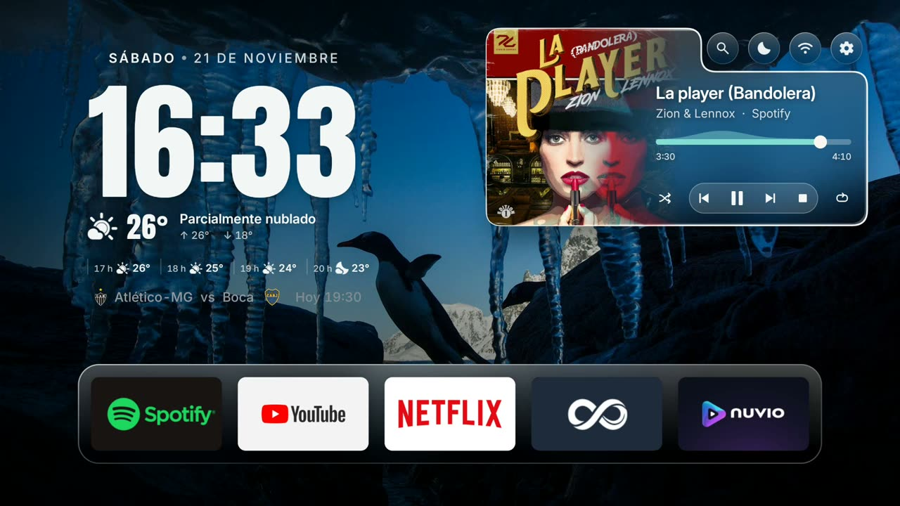
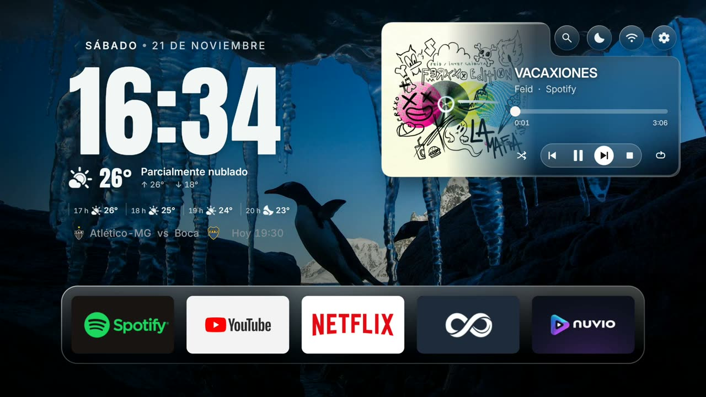
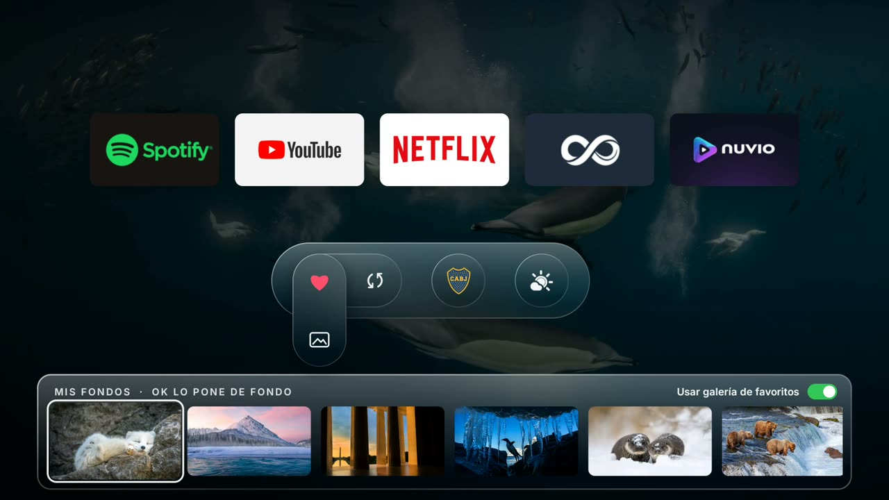
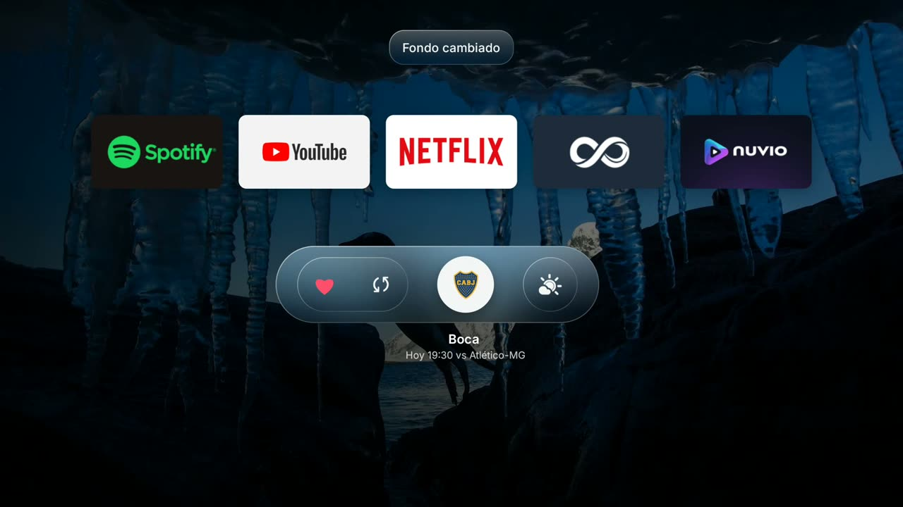
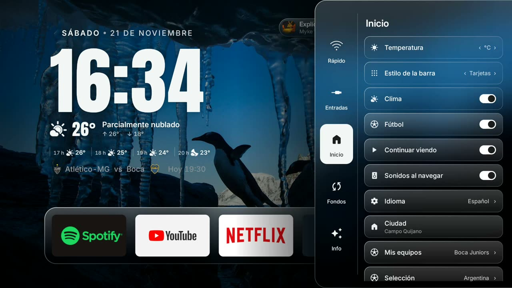
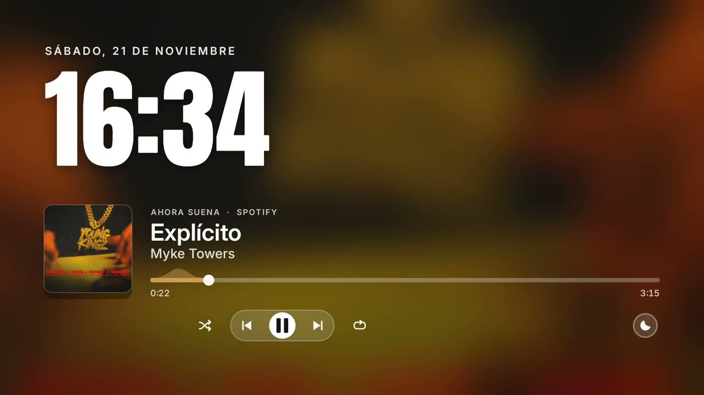

# Facurrin TV

**Hecho por Facurrin** · basado en [Free My TV](https://github.com/simbasjungles/free-my-tv) (código abierto, MIT) y su
adaptación argentina [Argentinoman/freemytv-argentinoman](https://github.com/Argentinoman/freemytv-argentinoman).

Un inicio limpio, rápido y sin publicidad para televisores con Android TV o Google TV, con aspecto de vidrio:
reloj grande, clima, los partidos de tus equipos, reproductor de música, fotos del día de Bing de fondo y un
protector de pantalla con tu música. Probado en una Noblex con Android 11.

<p align="center"></p>

<p align="center"><a href="media/facurrin-tv.mp4"><b>▶ Ver el video completo</b></a></p>

### Instalarlo

**Antes, en la tele (una sola vez):** Ajustes → Preferencias del dispositivo → Información → tocá 7 veces
*Compilación* hasta que diga que sos desarrollador. Después, en *Opciones de desarrollador*, activá **Depuración por
USB** (y *Depuración de red* o *ADB por red*, si tu tele lo tiene). El launcher lo necesita para convertirse en el
inicio de la tele.

#### Opción fácil: con Downloader (sin compu)

1. En la Play Store de la tele, instalá **Downloader** (de AFTVnews).
2. Abrilo, escribí el código **`4418755`** y apretá *Ir*.
3. Se descarga Facurrin TV. Si pregunta, permití que Downloader instale apps y tocá *Instalar*.
4. Seguí con el paso *Activarlo* de abajo.

El código siempre baja la última versión, así que sirve también para actualizar.

#### Opción con la compu (adb)

Descargá `FacurrinTV.apk` de [Releases](../../releases) y las
[herramientas de Android (adb)](https://developer.android.com/tools/releases/platform-tools). Con la IP de la tele
(Ajustes → Red):
```
adb connect IP-DE-LA-TELE:5555
adb install -r FacurrinTV.apk
adb shell cmd package compile -m speed -f io.freemytv
```
La tele pregunta *¿Permitir depuración?*: aceptá y marcá *Permitir siempre*. El último comando la deja más rápida.

#### Activarlo

Abrí la app *Facurrin TV* → *Pantalla de inicio* → *Facurrin TV*. Si la tele pregunta *¿Permitir depuración?*,
aceptá y marcá *Permitir siempre*. La primera vez aparece una **bienvenida** para elegir tu ciudad, tu equipo y el
fondo; todo se cambia después en el centro de control.

La versión para descargar no trae clave de TMDB: funciona todo menos las recomendaciones de películas y series.

### Apoyá el proyecto

Si te gusta Facurrin TV, podés ayudarme a seguir mejorándolo:

- **PayPal:** [paypal.me/facurrin](https://paypal.me/facurrin)
- **Desde Argentina:** transferencia al alias **facurrin** (Brubank), el monto que quieras.

En la tele también está: centro de control → *Info* → *Apoyá a Facurrin* (con un QR para el celular).

## Capturas

| | |
|---|---|
|  |  |
| **El inicio** | **Lo que seguís viendo, en cada app** |
|  |  |
| **Música** | **El reproductor abierto** |
|  |  |
| **Mis fondos** | **Tu equipo** |
|  |  |
| **Centro de control** | **Protector con tu música** |

## Volver al inicio original

En la tele: *Facurrin TV* → *Pantalla de inicio* → *Original*. Vuelven el inicio, el protector y las apps de fábrica
tal como estaban. Si el inicio nuevo falla tres veces en cinco minutos, vuelve solo al original.

Para sacarlo del todo: primero *Original*, después desinstalá *Facurrin TV* (Ajustes → Apps).

**Qué cambia en la tele:** pasa a ser el inicio y el protector de pantalla, y apaga (sin desinstalar) el inicio de
fábrica y algunas apps de publicidad de la marca. Imagen, sonido, entradas, control remoto, servicios de Google, Play
Store y las apps que guardaron una red Wi-Fi nunca se tocan.

## Compilarlo vos

Necesitás JDK 17, las herramientas de Android (build-tools 34 y platform android-34) y Git Bash en Windows.

```
./build.sh
```

La primera vez crea `config.properties`: poné tu ciudad (latitud y longitud) y, si querés recomendaciones de
películas y series, tu clave gratis de [TMDB](https://www.themoviedb.org/settings/api). Ese archivo y la llave de
firma (`freemytv.keystore`) son tuyos: no los subas a ningún lado. Las notas técnicas están en
[CLAUDE.md](CLAUDE.md).

## Privacidad

Sin cuentas, sin estadísticas, sin rastreo. La app consulta el clima (Open-Meteo), los partidos (ESPN), las fotos
del día de Bing, TMDB si pusiste una clave, y las páginas públicas de Spotify. Lo que se reprodujo en la tele queda en
la tele.

## Créditos

- **Hecho por Facurrin**, con [Claude Code](https://claude.com/claude-code).
- Basado en [Free My TV](https://github.com/simbasjungles/free-my-tv) (MIT) y en la adaptación argentina de
  [Argentinoman](https://github.com/Argentinoman/freemytv-argentinoman).
- Clima: [Open-Meteo.com](https://open-meteo.com/) (CC BY 4.0). Fútbol: marcadores públicos de ESPN. Fondos: fotos
  del día de Bing (archivo de [npanuhin/BingWallpapers](https://github.com/npanuhin/BingWallpapers)); fondo de paisaje
  con fotos de [Pexels](https://www.pexels.com/).
- Este producto usa la API de TMDB pero no está avalado ni certificado por [TMDB](https://www.themoviedb.org/).
- Íconos: [Material Symbols](https://fonts.google.com/icons) (Apache 2.0). Letras: [Inter](https://rsms.me/inter/) y
  [Anton](https://fonts.google.com/specimen/Anton) (SIL OFL 1.1).
- No está afiliado a Google, Noblex, TCL ni a ningún servicio de streaming. Los nombres y logos de las apps son de sus
  dueños.

## Licencia

[MIT](LICENSE).
